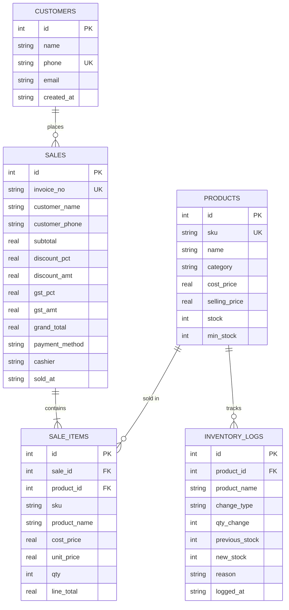

<div align="center">

# 🛒 Apna Market - POS & Inventory Management System

**A lightweight, production-grade Point of Sale (POS) and Inventory Manager desktop application built with Python, Tkinter, and SQLite.**

[](https://www.python.org/)
[](https://docs.python.org/3/library/tkinter.html)
[](https://www.sqlite.org/)
[](LICENSE)
[](#)
[](CONTRIBUTING.md)

[Features](#-key-features) • [Quickstart](#-quickstart) • [Jupyter Notebook](#-running-in-jupyter-notebook) • [Database Schema](#-database-schema) • [Screens](#-screens--walkthrough) • [Contributing](#-contributing)

</div>

---

## 📖 Overview

Designed specifically for **market businessmen, retail shopkeepers, and local grocery store owners**, this system provides a full-featured desktop workflow that requires zero complicated database servers or heavy web frameworks. It runs locally using Python's built-in **Tkinter** and **SQLite3**, with optional support for **Matplotlib** (interactive revenue charts) and **ReportLab** (printable PDF invoices).

Available both as an interactive **Jupyter Notebook (`market_pos_inventory.ipynb`)** and a modular standalone **desktop application (`market_app.py`)**.

---

## ✨ Key Features

- **📊 Smart Dashboard**:
  - Live KPI cards: Today's Revenue (₹), Units Sold Today, Low-Stock Count, and Active Catalog Count.
  - Automatic low-stock warnings with a 1-click **Quick Restock** modal.
  - Recent sales feed with timestamp and customer details.

- **🏷️ Product Catalog (CRUD)**:
  - Add, edit, update, and delete inventory items.
  - Fields for SKU / Barcode, Item Name, Category, Cost Price, Selling Price, Current Stock, and Min-Stock Alert Level.
  - Real-time search filter and visual color highlighting for low-stock products.

- **🛒 Fast POS & Checkout**:
  - **Barcode Scanner Compatible**: Instant lookup via USB/Bluetooth barcode scanner or manual SKU entry with Enter-to-Add.
  - Dynamic cart management with quantity increment/decrement (`+1` / `-1`) and real-time subtotal calculation.
  - Customer assignment (select existing customer or walk-in).
  - Configurable **Discount %** and **GST / Tax %** with automatic line-item and grand total calculations.
  - Payment modes: Cash, UPI / QR Code, and Debit/Credit Card.
  - Real-time stock verification to prevent overselling.

- **📦 Inventory Management & Audit Logs**:
  - Manual Stock In (Purchases/Restocks), Stock Out (Damages/Expired), and Audit Adjustments.
  - Complete, immutable audit log recording every inventory change, previous vs new stock, timestamps, and reasons.
  - Automatic stock deduction upon completed sales.

- **👥 Customer Management & Purchase History**:
  - Customer directory with phone number and email records.
  - Click any customer to view their complete historical transactions and previous orders.

- **📈 Analytics & Business Reports**:
  - Timeframe filtering: *All Time*, *Today*, *Last 7 Days*, *Last 30 Days*.
  - Financial insights: Total Revenue, Cost of Goods Sold (COGS), Gross Profit, and Profit Margin %.
  - Top 10 Best-Selling Products table.
  - Embedded daily revenue trend chart (powered by `matplotlib` with a neat tabular fallback).

- **🔐 Dual Role-Based Access Control**:
  - **Admin / Owner Mode**: Full access to financial metrics, cost prices, profit margins, and deletion privileges.
  - **Cashier Mode**: Restricts confidential profit figures and cost prices while keeping billing and search fast and accessible.

- **🧾 Automated Invoicing Engine**:
  - Generates professional PDF invoices (via `reportlab`) saved in `invoices/`.
  - Clean formatted receipt fallback (`.txt`) for standard thermal or text receipt printing.

---

## 🖥️ Screens & Walkthrough

```
+-----------------------------------------------------------------------------------+
| 🛒 APNA MARKET | POS & Inventory Management System            [Role: Admin] [Switch] |
+-----------------------------------------------------------------------------------+
| [ 📊 Dashboard ] [ 🏷️ Products ] [ 🛒 Billing / POS ] [ 📦 Inventory ] [ 📈 Reports ] |
+-----------------------------------------------------------------------------------+
|  Today's Revenue       Units Sold Today       Low-Stock Alerts       Total Products |
|     ₹ 12,450.00               84                      3                    45     |
+-----------------------------------------------------------------------------------+
| [ ⚠️ Low-Stock Warnings ]                 | [ 🕒 Recent Sales Activity ]            |
| - Assam Gold Tea 250g (Stock: 4 / Min: 6) | - INV-261021-01  Priya Sharma  ₹ 403.99 |
| - Herbal Bath Soap    (Stock: 3 / Min: 8) | - INV-261021-02  Walk-in       ₹ 273.00 |
| [ Quick Restock Selected ]                |                                         |
+-----------------------------------------------------------------------------------+
```

---

## 🚀 Quickstart

### Prerequisites
- Python 3.10+ (Tkinter and SQLite3 are included in standard Python)

### 1. Clone the Repository
```bash
git clone https://github.com/your-username/market-pos-inventory.git
cd market-pos-inventory
```

### 2. Create and Activate Virtual Environment
```bash
# On Windows
python -m venv .venv
.venv\Scripts\activate

# On Linux / macOS
python3 -m venv .venv
source .venv/bin/activate
```

### 3. Install Optional Dependencies
```bash
pip install -r requirements.txt
```
*(The system runs out-of-the-box using standard libraries alone; `matplotlib` and `reportlab` enhance charts and PDF output).*

### 4. Run the Desktop Application
```bash
python market_app.py
```

---

## 📓 Running in Jupyter Notebook

If you prefer an interactive notebook walkthrough:

1. Launch Jupyter Notebook or open [`market_pos_inventory.ipynb`](market_pos_inventory.ipynb) in **VS Code**:
   ```bash
   jupyter notebook market_pos_inventory.ipynb
   ```
2. Run the cells sequentially to inspect the database schema, seed demo data, and generate test invoices.
3. Run **Step 6** to launch the GUI desktop window directly from the notebook.

---

## 🗄️ Database Schema

The SQLite database (`market.db`) is structured with relational integrity:



---

## ⚡ Barcode Scanner Hardware Support

Standard USB and Bluetooth handheld barcode scanners emulate keyboard keystrokes (`HID keyboard mode`).
- In the **Billing / POS** tab, focus the `⚡ Barcode / SKU Scan` field.
- Scan any product barcode; the scanner automatically inputs the barcode number and sends `Enter`, adding the item instantly to the cart.

---

## 📂 Project Structure

```text
├── .github/
│   └── workflows/
│       └── ci.yml               # Automated CI test workflow
├── invoices/                    # Output directory for generated PDF & text bills
│   └── .gitkeep
├── .gitignore                   # Git ignore patterns (virtualenvs, databases, cache)
├── CONTRIBUTING.md              # Contribution and PR guidelines
├── LICENSE                      # MIT Open Source License
├── README.md                    # Project documentation & walkthrough
├── market_app.py                # Main standalone Tkinter + SQLite application
├── market_pos_inventory.ipynb   # Interactive Jupyter Notebook version
└── requirements.txt             # Optional package dependencies
```

---

## 🛠️ Tech Stack & Dependencies

- **Python 3.10+**: Core programming language
- **Tkinter & ttk**: Native desktop GUI toolkit
- **SQLite3**: ACID-compliant local database
- **[Matplotlib](https://matplotlib.org/)** *(Optional)*: Visual trend charts
- **[ReportLab](https://www.reportlab.com/)** *(Optional)*: Formatted PDF invoices

---

## 🤝 Contributing

Contributions, feature requests, and bug reports are welcome! Please check [CONTRIBUTING.md](CONTRIBUTING.md) for contribution guidelines.

1. Fork the Project
2. Create your Feature Branch (`git checkout -b feature/AmazingFeature`)
3. Commit your Changes (`git commit -m 'feat: Add AmazingFeature'`)
4. Push to the Branch (`git push origin feature/AmazingFeature`)
5. Open a Pull Request

---

## 📄 License

Distributed under the **MIT License**. See [`LICENSE`](LICENSE) for details.

---

<div align="center">
  <sub>Built with ❤️ for local markets, shops, and entrepreneurs.</sub>
</div>
